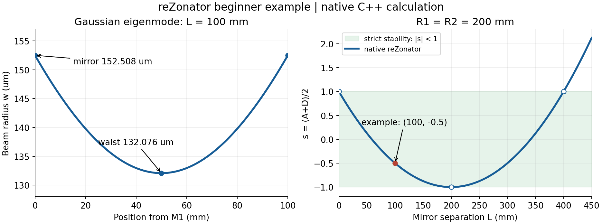

# reZonator 기초 실습: 두 구면 거울 사이의 Gaussian 빔

`RUN.bat`을 더블클릭하면 설치된 reZonator에서 `01_symmetric_cavity.rez`가 열립니다. **수동 광학계의 안정성과 공간 Gaussian 고유모드**를 배우는 약 20분 실습입니다. 레이저 이득이나 발진 임계값은 계산하지 않습니다.

처음에는 Optiland로 굴절·초점·광선 추적을 익힌 뒤 이 예제로 넘어오면 좋습니다. 다음 단계인 LightPipes에서는 유한 개구와 회절·간섭을 살펴볼 수 있습니다.



## 1. 무엇을 배우는가

- **ABCD 행렬**: 작은 각도의 광선이 광학계를 지날 때 위치와 각도가 어떻게 변하는지 표현합니다.
- **공진기 안정성**: 여러 번 왕복해도 빔이 기하학적으로 무한히 커지지 않는 조건을 확인합니다.
- **Gaussian 고유모드**: 한 바퀴 왕복한 뒤 같은 복소 빔 파라미터로 돌아오는 빔의 허리와 반경을 계산합니다.
- **T/S 평면**: 입사면과 그 수직 평면을 구분합니다. 이 예제는 수직 입사이므로 두 결과가 같습니다.

고유모드가 존재한다는 사실만으로 실제 레이저가 발진한다는 뜻은 아닙니다. 여기에는 펌프, 이득 매질, 거울의 반사율, 출력 결합, 손실 또는 발진 조건이 들어 있지 않습니다.

## 2. 광학계와 단위

```text
M1 (오목 구면 거울) —— 공기/진공 간격 L —— M2 (오목 구면 거울)
          z=0 mm          허리 z=50 mm          z=100 mm
```

| 입력 | 값 | 의미 |
|---|---:|---|
| 파장 λ | 632.8 nm | 진공 파장, 공기 굴절률을 정확히 1로 둠 |
| 공진기 종류 | Standing-wave / SW | 두 끝 거울 사이의 왕복 경로 |
| M1, M2의 R | 각각 200 mm | 거울 곡률반경, 거울의 지름이 아님 |
| M1, M2의 Alpha | 각각 0 deg | 수직 입사 |
| L의 L | 100 mm | 두 거울 사이의 거리 |
| L의 n | 1 | 빈 공간의 굴절률 |

이 모델의 거울 부호 규약에서는 양쪽 오목 거울에 모두 `R=+200 mm`를 넣습니다. Gaussian 반경 `w`는 **강도가 중심값의 1/e²가 되는 반경**입니다. 지름은 `2w`이며 FWHM과 다릅니다.

## 3. 처음 실행하고 읽는 순서

1. `RUN.bat`을 엽니다. 상대 경로로 `..\runtime\rezonator.exe`를 실행하므로 폴더 전체를 옮겨도 같은 구조에서 사용할 수 있습니다. 별도의 Python 설치나 패키지 설치는 필요 없습니다.
2. `File → Save As...`로 연습용 사본을 저장합니다. 실행기는 `--example` 옵션을 사용하므로 원본 예제를 직접 덮어쓰는 대신 사본에서 연습하기 좋습니다.
3. `Window → Schema` 또는 **F12**로 요소 표를 봅니다. `M1`, `L`, `M2` 행을 더블클릭하거나 선택 후 `Element → Properties...`를 열어 위 표의 값을 확인합니다.
4. `File → Change Wavelength...` 또는 **F10**에서 `632.8 nm`를 확인합니다.
5. 미리 열린 **Caustic** 창을 선택합니다. x축은 M1에서 잰 위치(mm), y축은 빔 반경(mm)입니다. 중앙 50 mm에서 최소이고 양쪽 거울에서 커지는 곡선이 나옵니다. `Beam radius` 모드인지 확인합니다. T와 S 곡선이 겹치는 것이 정상입니다.
6. 미리 열린 **Stability Map** 창을 선택합니다. 이 창의 x축은 빔 내부 위치가 아니라 **바꾸어 가정한 공진기 길이 L**입니다. `Normal` 모드는 `s=(A+D)/2`를 표시합니다. 현재 예제의 `L=100 mm`에서는 `s=-0.5`입니다.
7. 그래프 창이 겹치면 `Window → Tile`로 배열합니다. 변경 후 그래프가 갱신되지 않으면 해당 그래프에서 `Plot → Update` 또는 **F5**를 누릅니다.

창을 닫았다면 다시 만들 수 있습니다.

- `Functions → Caustic...` → `Element`에서 `L` 선택 → `Number of points`를 `101`로 설정합니다. 위치 범위는 선택한 간격 길이를 사용합니다.
- `Functions → Stability Map...` → 요소 `L`, 매개변수 `L` 선택 → `From=0 mm`, `To=450 mm`, `Number of points=451`로 설정합니다. 옵션에서 `Normal`을 선택합니다.
- 열린 그래프의 계산 범위는 `Plot → Update With Params...` 또는 **Ctrl+F5**로 바꿉니다.

메뉴 이름은 설치된 영문 UI 소스의 실제 표기를 기준으로 했습니다. `Functions → Round-Trip Matrix`로 행렬도 볼 수 있지만 기준 위치에 따라 A/B/C/D 각각은 달라질 수 있습니다. 아래 행렬은 **간격 중앙**을 기준으로 검증한 값이며, trace와 안정성은 기준 위치에 무관합니다.

## 4. 예상값과 간단한 손계산

두 거울의 안정성 인자는 `g₁=1−L/R₁`, `g₂=1−L/R₂`입니다. 현재는 둘 다 `0.5`이며 `g₁g₂=0.25`입니다. 왕복 행렬을 `M=[[A,B],[C,D]]`라고 하면 `s=(A+D)/2=2g₁g₂−1=-0.5`입니다.

엄격한 안정 조건은 `|s|<1`, 즉 `0<g₁g₂<1`입니다. `Squared` 표시 모드는 다른 물리량이 아니라 `1−s²`이므로 현재 값은 `0.75`입니다.

대칭 공진기의 허리는 중앙에 있습니다. `z_R=√[(L/2)(R−L/2)]`, `w₀=√(λz_R/π)`이며, M1에서의 위치를 z라고 하면 `w(z)=w₀√[1+((z−L/2)/z_R)²]`입니다. 이 식은 길이 단위를 모두 m로 맞춰 계산합니다.

| 계산값 | 예상값 |
|---|---:|
| Normal 안정성 s | −0.5 |
| Squared 안정성 1−s² | 0.75 |
| 허리 위치 | M1에서 50 mm |
| Rayleigh 길이 z_R | 86.602540 mm |
| 허리 반경 w₀ | 132.075911 μm = 0.132075911 mm |
| 양쪽 거울의 빔 반경 | 152.508125 μm = 0.152508125 mm |
| 중앙 기준 왕복 A, D | 각각 −0.5 |
| 중앙 기준 왕복 B | 0.075 m |
| 중앙 기준 왕복 C | −10 m⁻¹ |
| AD−BC | 1 |

길이 스캔의 `L=0, 200, 400 mm`에서는 `|s|=1`입니다. 특히 `L=R=200 mm`는 특별한 **공초점(confocal) 퇴화점**입니다. 이상적인 고유모드가 존재할 수 있지만 일반적인 비퇴화 고유모드 계산이 특이해질 수 있으므로 초급 실습의 안정 판정에서 경계점은 따로 취급합니다. 이 점을 일반적인 안정 영역 내부의 점과 동일하게 해석하지 마세요.

## 5. 값을 하나씩 바꿔 보는 연습

1. **파장만 1064 nm로 변경:** 안정성은 그대로이고 모든 빔 반경은 `√(1064/632.8)`배 커져야 합니다. 확인 후 632.8 nm로 복원합니다.
2. **간격 L만 50 mm로 변경:** `g₁=g₂=0.75`, Normal 안정성은 `0.125`입니다. 허리는 새 중앙인 25 mm로 이동합니다. Caustic 창의 x축 표시 범위를 조정하거나 다시 열어 봅니다.
3. **간격 L만 150 mm로 변경:** Normal 안정성은 `−0.875`입니다. 100 mm일 때와 허리 크기를 비교합니다. 안정하다는 조건만으로 모든 빔 반경이 같아지는 것은 아닙니다.
4. **간격 L을 450 mm로 변경:** Normal 안정성은 `2.125`로, 안정한 Gaussian 고유모드 조건을 벗어납니다. Caustic에서 정상적인 안정 모드 결과를 기대하지 않습니다. 실습 후 L=100 mm로 복원합니다.

한 번에 한 입력만 바꾸고 예상 방향을 먼저 적어 보세요. 예제의 대칭 공진기 손계산 식은 두 거울의 R이 같은 경우에만 사용합니다.

## 6. 실제 프로그램 검증과 파일 구성

`validate_native.bat`은 별도의 임시 검증 프로젝트를 생성하고 **설치된 reZonator 자체**를 실행합니다. `.rez`를 읽은 후 내장 Python의 `schema.round_trip()`를 통해 C++ `BeamCalculator` 결과를 가져옵니다. 외부 Python이 대신 광학 계산을 하는 방식이 아닙니다.

- T/S 두 평면의 101개 위치씩, 총 **202개 빔 반경**을 해석식과 비교했습니다.
- 두 평면의 중앙 왕복 행렬식과 Normal/Squared 안정성을 확인했습니다.
- 0–450 mm 길이 스캔의 **451개 안정성 값**도 native 계산과 해석식을 비교했습니다.
- 허용오차는 상대 `1e-10`, 절대 `1e-14`입니다. 마지막 검증 결과는 `validation/latest.json`의 경로에 있습니다.
- 검증은 원본 기본값을 대상으로 합니다. `01_symmetric_cavity.rez`를 직접 바꾸면 기본값 검증이 실패할 수 있으므로 연습은 사본에서 합니다.
- 동일 Qt SDK가 있으면 화면 없이 실행합니다. SDK 없이 runtime만 복사한 환경에서는 짧게 검증 창이 나타날 수 있습니다. 검증이 만든 프로세스만 종료하며 다른 reZonator 창은 종료하지 않습니다.

| 파일 | 역할 |
|---|---|
| `RUN.bat` / `open_example.bat` | 기본 예제를 로컬 앱으로 열기 |
| `01_symmetric_cavity.rez` | 편집 가능한 native 프로젝트와 두 기본 그래프 |
| `preview.png` | 실제 native 검증 데이터로 만든 미리보기 |
| `validate_native.bat` / `.ps1` | 원본 예제를 실제 앱으로 다시 검증 |
| `validation/native_report.py` | 검증 프로젝트에 포함되는 내장 Python 코드 |
| `validation/runs/*/native_report.json` | 실제 계산값, 해석값, 검증 결과 |
| `validation/runs/*/native_beam_samples.csv` | 위치별 T/S 빔 반경 비교표 |
| `validation/runs/*/provenance.json` | 사용한 실행 파일·예제 SHA256와 실행 시각 |
| `validation/create_project.py` | 예제 JSON 생성 코드; 일반 사용에는 실행 불필요 |
| `validation/render_preview.py` | 선택적 그림 재생성 코드; matplotlib 필요 |

검증 버전은 **reZonator 2.3.0+opt-sim-fix1**, 소스 commit `8eeea944bf6f811a0ec679d294ff5e9d79d6141d`, Qt 6.9.3, 내장 Python 3.12.10입니다. 실제 사용 실행 파일의 해시는 검증 결과에 기록됩니다. 기본 `.rez` 사용과 검증에는 별도의 Python 가상환경을 추가하지 않습니다. 그림 재생성만 선택적으로 matplotlib를 사용하며 기존 그림은 바로 열 수 있습니다.

## 7. 이 예제의 범위

이상적인 구면 거울, 작은 각도의 근축 ABCD 광학, 단일 Gaussian 모드, 균일한 공기/진공을 가정합니다. 유한 개구에 의한 회절·클리핑, 표면 수차, 정렬 오차, 열렌즈, 거울 코팅, 편광 의존성은 모델링하지 않았습니다. 반전·포화 이득·출력 에너지·펄스 형성·모드 잠금·비선형 전파도 포함하지 않습니다.

프로젝트 형식과 내장 계산 API는 설치된 원본 `bin/examples/spherical.rez`, `bin/examples/spherical_stability_py.rez`, `src/core/PyClassRoundTrip.h`, `src/core/PyModuleSchema.h`를 참고했습니다. GUI 이름은 `src/windows/ProjectWindow.cpp`, `src/windows/SchemaViewWindow.cpp`, `src/funcs/CausticOptionsPanel.h`, `src/funcs/StabilityMapWindow.cpp`에 정의되어 있습니다.
